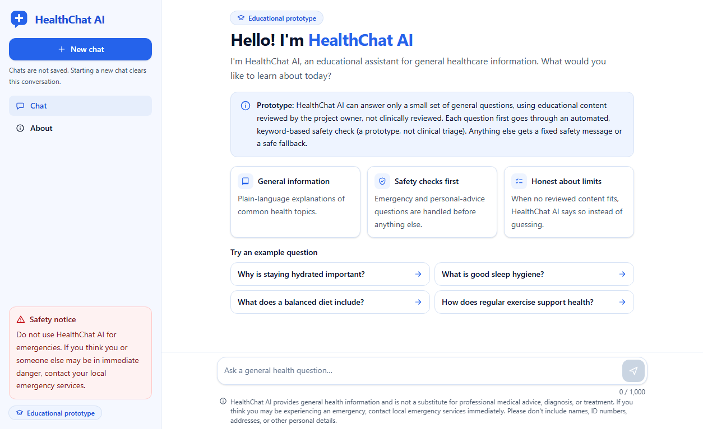
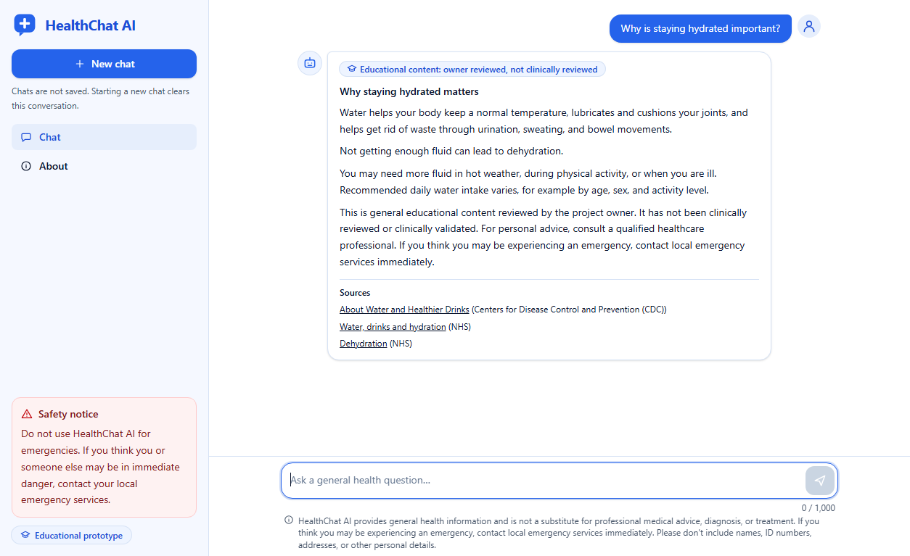
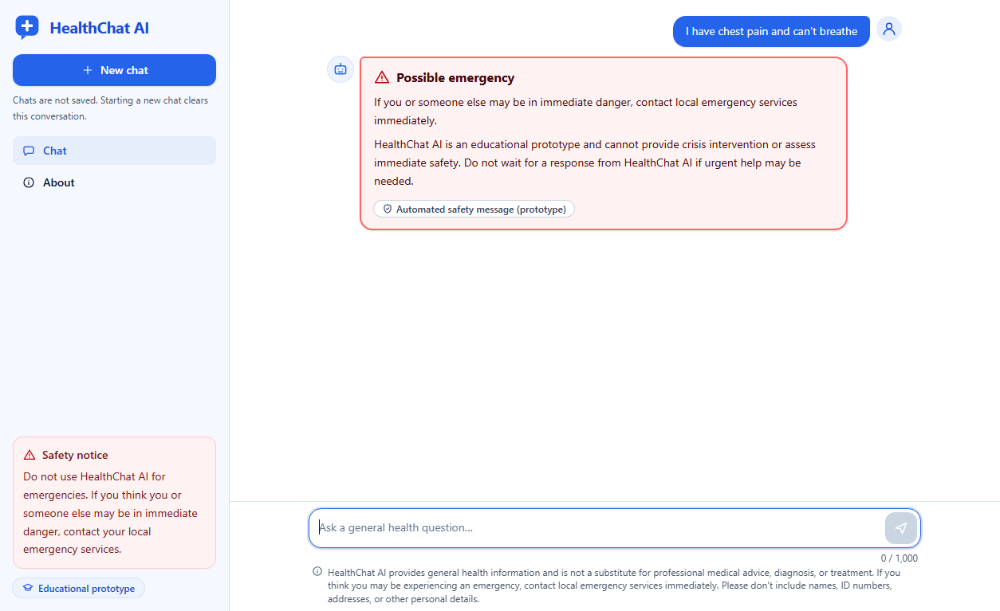
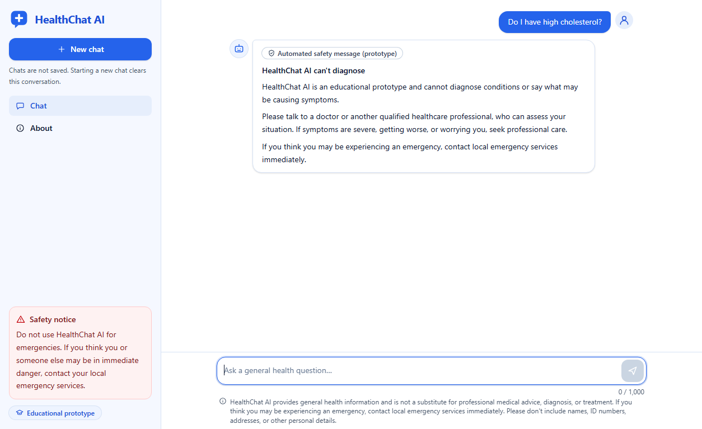
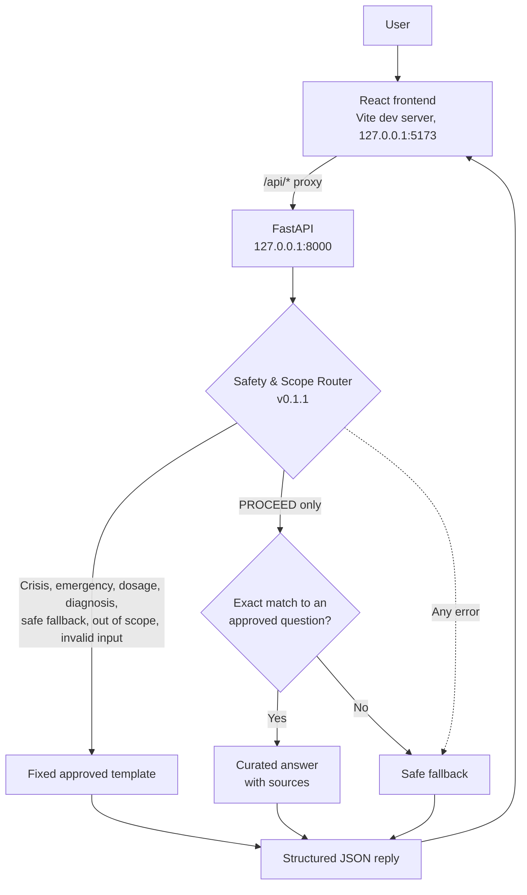

# HealthChat AI

**Educational Healthcare Q&A Chatbot**


> [!IMPORTANT]
> **Educational prototype only. HealthChat AI is not medical advice, diagnosis, or treatment.**
> It has not been clinically reviewed or clinically validated, and no clinician was involved in building it. Its emergency detection is a keyword-based prototype safeguard, not clinical triage, and it will miss some urgent messages. If you think you may be experiencing an emergency, contact your local emergency services immediately.

## Overview

HealthChat AI is a solo portfolio project that explores one question: **how should a health chatbot behave when it cannot be sure an answer is safe?**

The project started from a public dataset of about 112,000 doctor–patient Q&A records. Auditing that dataset showed its answers could not be trusted for display, so the design moved away from "retrieve the closest answer" and towards a safety-first approach. Every question passes through a rule-based safety router, and the system returns only fixed, pre-approved text. If nothing approved fits, it says so.

### Objectives

- Screen every question for emergency, crisis, diagnosis, and medication requests before anything else happens.
- Never show unverified dataset answers to users.
- Prefer a safe refusal over a guess, and fail closed on any internal error.
- Build a complete, tested full-stack application with a documented API contract.
- Report results and limitations honestly, including what was tried and not used.

### What the name does and doesn't mean

Despite "AI" in the name, the running application uses **no LLM, no embeddings, and no generative model**. Replies come from keyword rules and an exact lookup. This was a deliberate decision for a health context: every reply a user can see was written and reviewed in advance. TF-IDF NLP components were built and evaluated offline, but they are not connected to the application (see [Evaluation](#evaluation)).

## Main features

- **Safety-first routing:** a versioned keyword and pattern router assigns each question to one of eight priority-ordered routes.
- **Fixed replies only:** safety messages come from approved templates, and the reply text never includes the user's question.
- **One curated educational answer:** a hydration answer with CDC and NHS sources, returned only for exact approved questions.
- **Fail-closed pipeline:** any router or pipeline error returns the safe fallback.
- **Contract-validated API:** a documented FastAPI contract with structured errors that never echo request content. The frontend validates responses at runtime.
- **Privacy by design:** no chat history is stored, the access log is off, no external AI services are called, and the server binds to localhost only.
- **Reproducible data pipeline:** a read-only audit and traceable cleaning, with SHA-256 checks on the original dataset.

## Screenshots

These are real screenshots of the running application.

| Welcome screen | Curated answer with sources |
|---|---|
|  |  |

| Emergency routing | Diagnosis request declined |
|---|---|
|  |  |

`QueryMate Healthcare UI Dashboard.png` in the project root is an **early design concept under the project's former name, not a screenshot**. It shows features that were not built, and it is kept as a design reference.

## Technology stack

| Layer | Technologies |
|---|---|
| Backend | Python 3.12, FastAPI, Pydantic, Uvicorn |
| Frontend | React 19, TypeScript, Vite, Tailwind CSS |
| Data and NLP (offline only) | pandas, PyArrow, scikit-learn (TF-IDF, cosine similarity) |
| Testing | pytest, Vitest, Testing Library |
| Mock UI preview | Streamlit |

## System architecture



The offline components (dataset audit, cleaning, TF-IDF retrieval, and topic matcher) are separate from this flow. The API never reads the dataset. Code that touches the request path is in `src/querymate/pipeline.py`, `safety.py`, `knowledge.py`, and `api/`.

## How the safety routing works

`safety.route()` applies all its rules to the cleaned text, then returns the first matching route in this priority order:

| Priority | Route | Example trigger | Result |
|---|---|---|---|
| 0 | Invalid input | Empty or over 1,000 characters | Input message |
| 1 | Crisis | Self-harm, overdose, poisoning | Crisis guidance |
| 2 | Emergency | Chest pain, breathing difficulty, stroke-like signs | Emergency guidance |
| 3 | Dosage | "How much should I take?" | Declined, refer to a pharmacist or prescriber |
| 4 | Diagnosis | "Do I have…?" | Declined, refer to a professional |
| 5 | Safe fallback | Attempts to override the rules, demands for guarantees | Safe fallback |
| 6 | Out of scope | Animal health, non-health, insurance questions | Out-of-scope message |
| 7 | Proceed | Health vocabulary present and no risk rule fired | Curated lookup |

Key design choices:

- **`PROCEED` must be earned.** It requires positive health vocabulary and no risk rule. Uncertainty never defaults to proceeding.
- **Long messages are still scanned.** Crisis and emergency rules check the first 20,000 characters before the length limit is applied.
- **Conservative by default.** A general question such as "What are the warning signs of a stroke?" still gets the emergency reply, because keyword rules cannot tell it apart from someone watching a stroke happen.
- **Rules are versioned.** A fingerprint of the rule set is pinned in a test, so a rule change must come with a new router version.

**Known limitations.** The router has limited typo tolerance, handles English only, and has no conversation context. Urgent messages that don't use listed keywords are missed, for example indirect wording about self-harm. Some harmless questions are over-restricted. [docs/SAFETY_ROUTER.md](docs/SAFETY_ROUTER.md) lists these in detail.

## How the curated educational answer works

The only answer text the application can display is in [curated/topic_content.json](curated/topic_content.json). It has one entry, on hydration.

1. The router must return `PROCEED`.
2. After normalising case, punctuation, and spacing, the question must exactly match one of six approved wordings, such as "Why is staying hydrated important?".
3. The entry must be marked `owner_reviewed` and have sources.

If any step fails, the user gets the safe fallback. Each factual statement in the answer is mapped to its source (CDC or NHS), and the file is rejected unless it records that the content has not been clinically reviewed.

**Owner review means the project owner checked the content against its sources. It is not clinical review.**

**Trying it out:** only the hydration question returns an answer. The other example questions on the welcome screen correctly return the safe fallback, because no reviewed content exists for those topics.

## Dataset usage and limitations

The dataset is `Doctor-HealthCare-100k.csv` (112,156 rows; instruction, input, and output columns), used for auditing, cleaning, and offline retrieval experiments only.

- **Dataset answers are never displayed.** They are unverified, and no dataset text reaches the API or the curated content.
- **The dataset is not in this repository.** Its license and provenance are unverified, so it should not be redistributed, and this project should not be publicly deployed on it, until permitted use is established.
- **Not needed to run the app.** You only need it for the audit, cleaning, and dataset evaluation scripts. Tests that depend on it are skipped automatically when it is absent.
- **Cleaning is technical only.** No rows are deleted, each row keeps its source index and text hashes, and `display_allowed` is always false.
- **Why answers aren't displayed:** the audit found prescriptions, dosages, diagnostic certainty, a doctor persona, and corrupted text in the answers, plus conflicting answers to identical questions (37 question groups, 191 rows).

To reproduce the data work, place the original CSV in `data/raw/` without editing it, then run:

```powershell
.venv\Scripts\python.exe scripts\run_audit.py      # about 4 minutes
.venv\Scripts\python.exe scripts\run_cleaning.py   # about 2 minutes
```

Outputs go to the gitignored `reports/` and `data/processed/` folders.

## Installation and local execution

These commands are for Windows PowerShell. Requirements: **Python 3.12** and **Node.js** (tested with v24).

```powershell
git clone https://github.com/EnasAlshuaili/healthchat-ai.git
cd healthchat-ai

# Backend dependencies
py -3.12 -m venv .venv
.venv\Scripts\python.exe -m pip install -r requirements.txt

# Frontend dependencies
cd frontend
npm ci
cd ..
```

Run the app in two terminals from the project root:

```powershell
# Terminal 1: backend at http://127.0.0.1:8000
.venv\Scripts\python.exe scripts\run_api.py
```

```powershell
# Terminal 2: frontend at http://127.0.0.1:5173
cd frontend
npm run dev
```

Open **http://127.0.0.1:5173**. To confirm the backend is running, open http://127.0.0.1:8000/api/health. It should report `"status":"ok"`.

No API keys or `.env` file are needed. The optional settings are listed in [.env.example](.env.example).

### Streamlit preview (optional)

```powershell
.venv\Scripts\python.exe -m streamlit run app.py
```

This is an earlier **mock-only** interface at http://localhost:8501. It isn't connected to the safety router or any answer source, and it shows fixed placeholder replies.

## Testing

```powershell
# Backend tests
.venv\Scripts\python.exe -m pytest

# Frontend tests, type checking, and production build
cd frontend
npm test
npm run typecheck
npm run build
```

To run the live API tests, start the backend first, then run this from `frontend/`:

```powershell
$env:VITE_QUERYMATE_LIVE_API = "http://127.0.0.1:8000"
npx vitest run src/api/live.test.ts
```

| Check | Result |
|---|---|
| Backend tests (pytest) with the local dataset | 694 passed |
| Backend tests (pytest) on a fresh clone without the dataset | 680 passed, 14 skipped |
| Frontend tests (Vitest) | 187 passed; 13 live tests skipped by default |
| Live API tests against a running backend | 13 passed |
| Type checking | Passed |
| Production build | Passed |

These tests show that the software behaves as specified. They are not evidence of clinical safety or medical accuracy.

## Evaluation

All evaluation used small, hand-written synthetic question sets, and every figure below is provisional. The 60-question held-out test set has **not** been run, so there is no independent performance estimate.

| Component | Status | Validation result |
|---|---|---|
| Safety router v0.1.1 | **Connected** | Of 40 questions: 37 passed (2 of them pending a matcher step that isn't connected), 3 went to a restrictive but wrong category, 0 critical failures. All 5 urgent questions reached an urgent route. |
| TF-IDF retrieval baseline | Not connected | Similarity score did not separate answerable from unanswerable questions (AUC 0.24, n = 10 vs 10), so no threshold was chosen. |
| Topic matcher | Not connected | Best configuration accepted 5 of 10 topic questions correctly with no wrong topics (n = 20). |

Important caveats:

- The router's 0 critical failures came **after** rules were changed in response to two critical failures in the first validation run (v0.1.0). The v0.1.1 result is therefore not independent confirmation.
- Five urgent questions is a smoke test. It says nothing reliable about emergency recall.
- The rules and the evaluation questions were written with the same AI assistant, so the rules may reflect that wording and results may be optimistic.

## Project structure

```text
src/querymate/         Application package: safety router, pipeline, knowledge lookup,
                       plus the offline audit, cleaning, retrieval, and matcher modules
src/querymate/api/     FastAPI layer
frontend/              React + TypeScript client
curated/               Topic catalogue and the owner-reviewed educational answer
eval/                  Hand-written validation and test question sets
scripts/               API runner, audit, cleaning, and evaluation scripts
tests/                 Backend test suite
docs/                  Requirements, design, safety, API contract, and decision log
app.py, app_pages/     Mock-only Streamlit preview
data/, reports/        Local data and generated outputs (gitignored)
```

The project was renamed from QueryMate to HealthChat AI. The `querymate` Python package, `QUERYMATE_*` variables, and some internal file names keep the old name on purpose, and the older documents are historical records.

Useful starting points: [API contract](docs/API_CONTRACT.md), [safety router](docs/SAFETY_ROUTER.md), [decision log](docs/DECISIONS.md), and [safety and risk assessment](docs/07_Safety_and_Risk_Assessment.md).

## Privacy

No chat history is stored. No external AI services are used, and no questions or dataset content leave the machine. Please don't enter names, ID numbers, or other personal details.

## Disclaimer

HealthChat AI is an educational prototype built for learning and portfolio purposes. It provides general health information only, and it is **not medical advice, diagnosis, or treatment**. It is not clinically reviewed or clinically validated, it is not production-ready, and it should not be relied on for any health decision. Always consult a qualified healthcare professional about your health.
